<picture>
  <source media="(prefers-color-scheme: dark)" srcset="assets/banner-dark.svg">
  
</picture>

I turn AI models into systems that work in the real world: model development, optimized inference on edge devices, and the software around them.

**[Portfolio](https://maliyildirim.vercel.app/en/)** · [Türkçe](https://maliyildirim.vercel.app/tr/) · [LinkedIn](https://www.linkedin.com/in/mali-yildirim/) · [Email](mailto:muali.yldrm@gmail.com)

### Selected work

**[AI-powered search & rescue system](https://github.com/maliyildirim/ai-search-and-rescue-drone-system)** — Bachelor’s thesis, two-person team  
An IMX477 camera on a drone, YOLOv11 on a Jetson Nano and a DeepStream RTSP stream: an end-to-end system, tested in the field, that marks people and leaves the final decision to the operator. [Case study](https://maliyildirim.vercel.app/en/work/edge-system/)

**[LabelMate](https://github.com/maliyildirim/labelmate)** — Independent software, MIT licence  
The model proposes boxes; a person reviews and corrects them, and the result becomes a YOLO-format label. It runs locally and offline, so the data stays on the machine. [Case study](https://maliyildirim.vercel.app/en/work/labelmate/)

**[Drone vs Bird](https://github.com/maliyildirim/drone-vs-bird-realtime-detection)** — Workplace training at Boğaziçi Savunma  
A two-stage real-time pipeline that detects drones and tells them from birds. TensorRT FP16 took it from 12.8 to 26.0 FPS on an RTX 3060. [Case study](https://maliyildirim.vercel.app/en/work/drone-vs-bird/)

Also on the portfolio: a published article on identifying PCB materials from thermal images (TÜBİTAK 2209-A, *Gazi University Journal of Science Part A*, 2026), and brake-pad image analysis and Rail3D point-cloud classification from the TÜBİTAK RUTE internship.

**Tools:** Python · PyTorch · Ultralytics YOLO · TensorRT · DeepStream · Jetson · ByteTrack · Open3D · LightGBM · PySide6
